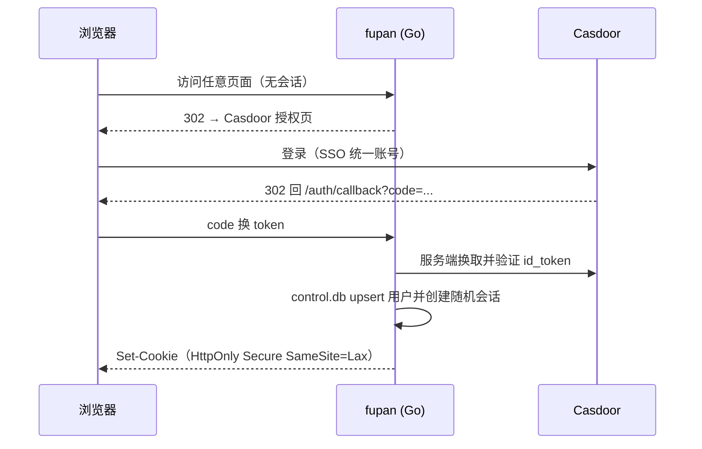

# 复磐 FuPan 多用户改造设计提案

## 实施定稿

以下内容是当前实现与部署的唯一依据；后文 A/B 方案及接入草稿仅保留为历史比较，不再作为实施指令。

- **实际采用方案 B**：每用户独立 SQLite，业务库位于 `data/users/<内部UUID>/fupan.db`；独立 `data/control.db` 保存 `(issuer, sub)` 到内部 UUID 的映射、OIDC state 和服务端随机会话，会话只存 token hash。业务 handler 通过请求级 `TenantServices` 获取当前用户服务，按用户懒加载、初始化失败不缓存，不在共享 Store 上动态切换用户；首版不做 LRU。
- **双部署模式**：默认 `FUPAN_NO_AUTH=true` 为独立部署，无登录、固定 `local` 用户和 `data/fupan.db`，适合个人复刻；`FUPAN_NO_AUTH=false` 为联合部署，使用 OIDC Authorization Code + PKCE，校验 state、nonce、issuer、audience 和有效期，白名单在回调及每次请求时检查。OIDC 认证或控制库故障不会回退旧根库。独立部署没有访问控制，公开监听即允许访客读写；loopback 监听时额外启用 Host/DNS rebinding 防护。
- **方案 A 未实施**：历史 SQL 中重复出现的 `ALTER TABLE libraries ADD COLUMN owner_id` 是草稿笔误，不是要执行两次的迁移；当前没有 owner 列或共享业务库行级授权。
- **旧库不能直接复制**：禁止把在线 SQLite 主库或 WAL sidecar 直接拷给 admin。实际使用停服后的 `./fupan -migrate-legacy`，通过 SQLite 一致性备份、临时副本升级、integrity/foreign-key/行数校验和原子落位完成离线迁移；源根库只读保留，目标存在时拒绝覆盖。
- **环境秘密不共享**：`FUPAN_LLM_API_KEY` 等环境 LLM Key 只作为 NoAuth 本地模式兜底。OIDC 租户不继承环境 Key，每用户在自己的设置中配置；自定义端点必须是 HTTPS 且 host 在允许列表中。
- **OIDC 向量强制禁用**：每租户固定使用 NoopStore，不连接 Milvus。`library_id` 或 UUID 唯一性不是用户授权边界，不能据此开放共享向量库；未来启用前必须另做租户隔离设计。
- **登出是本地会话登出**：前端 `POST /auth/logout` 删除服务端会话并清除 Cookie，再进入 `/auth/logged-out`；首版不依赖 Casdoor 单点登出。
- **配置只走环境变量**：`-config` 尚未支持，传入会明确报错。

## 背景

FuPan 原先按「本地优先、无登录、单用户」设计。公网部署目标是接入 Casdoor SSO，实现「一人一份」：每个用户有独立的知识库、复习进度、LLM API Key 等配置。

## 一、现有代码基础（历史评估）

- 单二进制 + SQLite，表结构：`libraries / documents / chunks / cards / schedules / review_logs / card_proposals / settings`
- 原 `settings` 表是单库全局 KV（`key TEXT PRIMARY KEY`）；方案 B 下每个用户各有一张，因此天然隔离
- 已有迁移框架（`internal/repo/sqlite/migrations/`，`schema_migrations` 表 + 顺序重放）
- NoAuth 下 Milvus 不可达时可降级 NoopStore；认证与控制库不采用这种降级策略

## 二、两个候选方案（历史比较）

### 方案 A：加 owner 列（共享库 + 行级隔离）——未采用

历史草案曾考虑在 `libraries` 表加 `owner_id`，并把 `settings` 改为用户维度：

```sql
-- 仅历史示意，未进入实际 migrations
ALTER TABLE libraries ADD COLUMN owner_id TEXT NOT NULL DEFAULT '';
UPDATE libraries SET owner_id = 'admin';

CREATE TABLE IF NOT EXISTS user_settings (
    user_id TEXT NOT NULL,
    key     TEXT NOT NULL,
    value   TEXT NOT NULL,
    PRIMARY KEY (user_id, key)
);
```

其他表（documents/chunks/cards/...）原计划不增加列，而是要求所有查询都通过 library 归属过滤。

优点：
- 标准多租户模式，将来可做「共享知识库」「协作」等特性
- 单库单连接，事务、备份逻辑不变

缺点：
- 所有 repo 查询都要带 owner 过滤，漏一处就是越权
- 实施定稿未采用此路径，以上 SQL 不应在现有库执行

### 方案 B：一人一个 SQLite 文件（实例级隔离）——实际采用

利用 `Config.DataDir`，按控制库生成的内部 UUID 打开 `data/users/<uid>/fupan.db`：

```go
// 路径示意；实际由 tenant.Manager 校验规范 UUID 并懒加载
path := filepath.Join(dataDir, "users", internalUserUUID, "fupan.db")
```

优点：
- **业务 schema 无需 owner 列**——现有单用户模型保留，`settings` 一人一份
- 物理隔离，误操作或单库损坏不影响其他用户
- 每个新库使用现有迁移框架建表

缺点与当前边界：
- 不支持跨用户查询或共享协作
- 连接数随已登录用户增长；首版限定少量白名单用户，不做 LRU
- 请求级服务只认控制库内部 UUID，外部 sub、library ID 和 document ID 都不能替代鉴权
- 存量数据必须走显式离线迁移，不能直接复制在线数据库或 WAL 文件

### 历史结论与最终选择

历史比较曾认为 B 适合少量个人用户、A 适合未来协作。最终已明确选择 **B + control.db + 请求级 TenantServices**；共享协作不在首版范围内。

## 三、认证接入（实施口径）

Casdoor 端：
1. 新建应用 `fupan`，Redirect URI 填 `https://fupan.example.com/auth/callback`
2. 将 Client ID / Client Secret 配到服务端环境变量

```bash
FUPAN_OIDC_ISSUER=https://sso.example.com
FUPAN_OIDC_CLIENT_ID=xxx
FUPAN_OIDC_CLIENT_SECRET=xxx
FUPAN_REDIRECT_URL=https://fupan.example.com/auth/callback
FUPAN_ADMIN_SUB=admin-sub
FUPAN_ALLOWED_SUBS=user-a-sub,user-b-sub
FUPAN_ALLOWED_ENDPOINT_HOSTS=llm-internal.example.com  # 可选，追加自定义端点 host
```

流程（Authorization Code + PKCE）：



- `(issuer, sub)` 唯一映射稳定内部 UUID；显示名不是身份键
- 服务端 session 有效期 7 天，数据库只保存 token hash；登录轮换会话
- 所有业务 API 需要鉴权，未登录 API 返回 401，页面跳登录；health 与 auth 路由是明确例外
- OIDC 写请求校验与 `FUPAN_REDIRECT_URL` 同源的 `Origin`
- 登出使用 POST，删除服务端会话后进入 `/auth/logged-out`

## 四、配置隔离（实施口径）

- LLM API Key、复习参数、搜索配置均存于每用户业务库，互不可见
- OIDC 租户不继承 `FUPAN_LLM_API_KEY` 或其派生嵌入 Key；环境 Key 仅用于 NoAuth 本地兜底
- OIDC 自定义 Base URL 必须是无 userinfo 的 HTTPS URL，host 必须在内置列表或 `FUPAN_ALLOWED_ENDPOINT_HOSTS` 中
- 设置写入使用 key allowlist，不能借设置接口写入内部用量或其他受保护键

## 五、Milvus 处理（首版强制禁用）

公网 OIDC 首版不部署也不连接 Milvus，Compose 设置 `FUPAN_VECTOR_DISABLED=1`，租户装配固定 NoopStore。`FUPAN_MILVUS_ADDR` 不会为 OIDC 开启向量。

历史草案中「library UUID 全局唯一，因此按 library_id 过滤即可授权」的判断已废弃：UUID 不可猜测不等于经过用户授权，空 Filter、表达式安全和删除补偿也都需要独立设计。未来启用向量前必须另立方案，强制 tenant scope 或每用户 collection，并明确维度策略与失败补偿。

## 六、部署、离线迁移与回滚顺序

- 应用示例为单容器，数据目录 `/data`；反向代理提供 HTTPS，应用仅保留 8080
- 2C2G 部署不运行 Milvus；旧根库 `data/fupan.db` 只能按下列流程归给 admin
- 保留旧二进制、旧根库和备份，直到双用户验收及重启验收完成

1. **备份与停服**：保留旧二进制和部署配置，停止旧服务后完整备份数据目录；不要复制仍在写入的 WAL 数据库。
2. **配置 OIDC env**：设置 `FUPAN_NO_AUTH=false`，以及 issuer、client、redirect、admin、白名单和 `FUPAN_DATA_DIR`；`-config` 当前不支持。
3. **离线迁移**：执行 `./fupan -migrate-legacy`。该命令不启动 HTTP，源库只读保留，自动输出一致性备份和 admin 目标路径；重复执行不会覆盖已有目标。
4. **启动**：确认 HTTPS 与 `FUPAN_VECTOR_DISABLED=1` 后启动新二进制。旧根库存在而 admin 尚未迁移时会拒绝业务访问，不会自动用空库顶替。
5. **双用户 smoke**：两个真实 Casdoor 白名单账号分别登录，将原始 session token 通过 `FUPAN_A_COOKIE` / `FUPAN_B_COOKIE` 传给 `scripts/smoke_multiuser.sh`，参数使用实际站点 base URL。脚本验证 `/api/me`、同名库列表、模型设置和 direct document ID 404，并清理测试数据。
6. **其余验收**：重启确认持久化；验证登出及 `/auth/logged-out`；撤销白名单后确认已有会话也不能继续访问。
7. **回滚**：停止新服务，用保留的旧二进制、旧根库和备份恢复原部署；在确认不再需要回滚前不删除任何旧产物。

## 七、验收清单

- [ ] 未登录访问任意页面/API → 302 到登录或 401
- [ ] 用户 A、B 的 `/api/me` 不同，同名知识库互不可见
- [ ] A、B 设置不同模型/API Key，各自生效且互不串读
- [ ] direct document ID 跨用户访问返回 404
- [ ] 复习进度（schedules/review_logs）互不影响
- [ ] admin 能看到经离线迁移的旧库数据，源根库保持不变
- [ ] 本地显式 `FUPAN_NO_AUTH=1 FUPAN_ADDR=127.0.0.1:8080` 行为保持单用户
- [ ] OIDC 始终禁用向量，不连接 Milvus
- [ ] 重启持久化、POST 登出、白名单撤销及旧二进制回滚路径均通过真实部署验收
